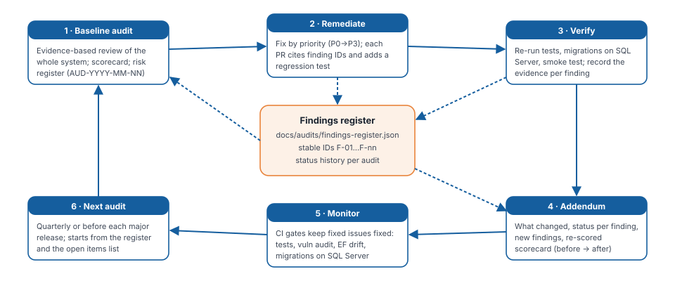

# Engineering Audit Programme

This folder makes audits **repeatable and comparable**. Every audit builds on the previous one instead of
starting from scratch.

| File | Purpose |
| --- | --- |
| [findings-register.json](findings-register.json) | Single source of truth: every finding's stable ID (`F-01`…), severity, category, current status and per-audit history |
| [AUDIT-HISTORY.md](AUDIT-HISTORY.md) | One row per audit: date, commit, score, maturity, counts |
| `../deliverables/08-professional-engineering-audit.*` | Baseline audit AUD-2026-11-01 (frozen, HTML + PDF) |
| `../deliverables/08-professional-engineering-audit-addendum.*` | Remediation review AUD-2026-11-01-R1 (HTML + PDF) |
| `../tools/findings.py` | Prints the register as a summary or a Markdown status table |
| `../tools/build_deliverables.py` | Rebuilds every deliverable (HTML + PDF) from `../deliverables/src/*.md` |

## Audit vision

1. **Evidence over opinion.** Every finding cites a file, line, test, command output or observed behaviour. If
   something cannot be verified, the audit says so.
2. **Stable IDs, never renumbered.** A finding keeps its ID for life. New audits append new IDs.
3. **Status is earned with evidence.** A finding is *Fixed* only when the fix is verified (a test, a CI gate, a
   reproducible command). *Partially fixed* means code is done but an operational or external step remains.
4. **CI keeps fixed things fixed.** Each critical fix gets a regression test or a CI gate: tests, the
   vulnerability gate, EF drift check, and migrations applied to real SQL Server.
5. **Comparable scores.** Every audit uses the same 26 areas and weights (sum 105, normalised), and the same
   capping rule: open Critical findings cap the reported score at 4.5, open High findings cap it at 6.5.
6. **Honest maturity.** Maturity labels describe what is verified, not what is planned.

## Lifecycle



1. **Baseline audit** (`AUD-YYYY-MM-NN`): full review using the master audit brief; produce the report,
   risk register and scorecard; create or extend the findings register.
2. **Remediate** by priority (P0 → P3). Each PR cites finding IDs and adds a regression test.
3. **Verify**: tests, migrations on SQL Server, smoke test, vulnerability audit. Record the evidence.
4. **Addendum** (`AUD-…-R1`, `-R2`…): what changed, status per finding, new findings, re-scored scorecard.
5. **Monitor**: the CI gates run on every push.
6. **Next audit**: quarterly, or before any production release or major feature. It starts from the open items
   in the register.

## How to run the next audit

```bash
python docs/tools/findings.py open        # what is still open, with remaining actions
python docs/tools/findings.py summary     # counts by severity/status
dotnet test GiftOfTheGivers.slnx --collect "XPlat Code Coverage"
dotnet list GiftOfTheGivers.slnx package --vulnerable --include-transitive
dotnet ef migrations has-pending-model-changes --project GiftOfTheGivers/GiftOfTheGivers.csproj --startup-project GiftOfTheGivers/GiftOfTheGivers.csproj
```

Then:

1. Add an entry to `audits` in the register (ID, date, commit, scores, maturity).
2. For every finding you re-check, append a `history` entry `{ audit, status, evidence }` and update
   `currentStatus`.
3. Add new findings with the next free ID and `"baselineReference": "new"`.
4. Write the report source in `docs/deliverables/src/` (copy the addendum's structure). Run
   `python docs/tools/build_deliverables.py` to produce HTML and PDF.
5. Add a row to [AUDIT-HISTORY.md](AUDIT-HISTORY.md).

## Severity and priority

| Severity | Meaning |
| --- | --- |
| Critical | Likely to cause severe compromise, data loss or major system failure |
| High | Significant security, reliability or functionality concern |
| Medium | Meaningful maintainability, usability, operational or performance concern |
| Low | Limited impact or non-urgent improvement |

Priority (P0–P3) is decided separately from severity. It considers likelihood, exposure, dependencies and effort.
