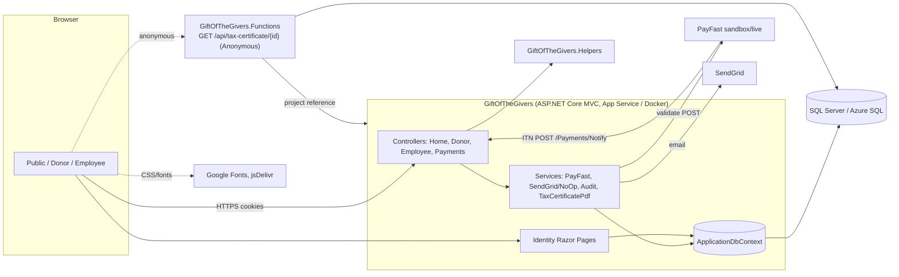

<div class="callout warn"><strong>Read this with the addendum.</strong> This document records the system <em>as it was found</em> and is kept unchanged as the baseline for future audits. Remediation work, verification evidence, new findings and the re-scored scorecard are in <a href="08-professional-engineering-audit-addendum.html">08 — Audit Addendum (Remediation Review)</a>. Risk IDs R1–R18 below map to stable finding IDs in <code>docs/audits/findings-register.json</code>.</div>

## Audit metadata

| Item | Value |
|---|---|
| Repository | `jBlack-MC/GiftOfTheGivers-HumanitarianAid` (GitHub; mirrored to Azure DevOps) |
| Branch audited | `feature/erd-schema-and-pdf` |
| Commit | `efa2b02d252399706574f7fca6eda43a298fd991` (45 commits in history) |
| Audit date | 2026-11-02 |
| Method | Static inspection of every first-party source, view, config, migration, test, workflow and doc file, plus local execution of the existing restore, build and test commands |
| Working tree | Clean before and after the audit. No project files were modified; this report is the only file added. |

### Applications and services discovered

| Project | Type | Purpose |
|---|---|---|
| `GiftOfTheGivers/` | ASP.NET Core MVC + Razor Pages (Identity UI), .NET 10 | The whole product: public site, donor portal, employee portal |
| `GiftOfTheGivers.Helpers/` | .NET class library (packaged to Azure Artifacts) | Three small calculation helpers |
| `GiftOfTheGivers.Functions/` | Azure Functions (isolated worker, v4) | One HTTP function that generates a tax-certificate PDF |
| `GiftOfTheGivers.Tests/` | xUnit | Unit tests |

**Technologies detected (with evidence):** C# / .NET SDK 10.0.401 (`global.json`), EF Core 10.0.12 on SQL Server / LocalDB / Azure SQL, ASP.NET Core Identity (cookie auth, roles), Bootstrap 5 + jQuery validation (vendored in `wwwroot/lib`), QuestPDF, SendGrid, PayFast (South African payment gateway), Serilog (console sink), Docker / Docker Compose, GitHub Actions (4 workflows), Azure Pipelines, Azure App Service (README), GHCR, Azure Artifacts.

**Not present (verified by search):** mobile applications, desktop applications, SPA framework, GraphQL/gRPC/WebSockets, queues or background workers, infrastructure-as-code, Kubernetes, file upload, monitoring/APM integration, backup configuration.

### Checks actually executed

| Command | Result |
|---|---|
| `dotnet restore GiftOfTheGivers.slnx --locked-mode` | **Succeeded.** NuGet audit raised **NU1903 (high)** and **NU1902 (moderate)** for transitive `System.Security.Cryptography.Pkcs` 9.0.11, plus NU1900 (it could not reach the Azure Artifacts feed for vulnerability data). |
| `dotnet build GiftOfTheGivers.slnx -c Release --no-restore` | **Succeeded:** 0 errors, 11 warnings (all NuGet). All four projects compiled, including Functions. |
| `dotnet test GiftOfTheGivers.slnx -c Release --no-build` | **Passed:** 19 / 19 tests, about 2 s. |
| Secret-pattern scan of the full git history (values never printed) | No real credentials found. Historical Azure SQL strings are `<placeholder>` values. The PayFast ID/key in `appsettings.json` match PayFast's public sandbox merchant. |

**Not executed:** the app was not run in a browser, and no live site, database, PayFast, SendGrid, Azure or CI system was contacted. Migrations were not applied, and CI pipelines were not observed running. Any statement about runtime UI behaviour, the live deployment or pipeline success comes from code inspection only and says so.

### Exclusions and limitations

- Vendored `wwwroot/lib/**` (Bootstrap, jQuery, jquery-validation) was not reviewed line by line.
- Migration `*.Designer.cs` files and `ApplicationDbContextModelSnapshot.cs` are generated. They were inspected only to check that they match the model and that EF can discover each migration.
- `wwwroot/intro/intro.js` (~400 lines of animation) was skimmed for redirect, skip and reduced-motion behaviour only.
- No requirements document, rubric, user stories or issue tracker is in the repo. Code comments refer to "Section B ERD" and "Portfolio of Evidence Part 1", which suggests an academic brief that was **not supplied**. Requirements below come from the README and code comments only.
- **Live deployment:** Unable to verify from the available evidence which environment (`ASPNETCORE_ENVIRONMENT`), database or configuration the README's live Azure site uses.

---

# PART I — PROJECT AND PRODUCT ASSESSMENT

## 4. Executive Summary

1. **Intended purpose.** A management web app for a humanitarian NGO. It covers public information, donations (ZAR/USD/EUR, one-time or recurring), volunteer applications, contact inquiries, a donor portal (history and Section 18A tax certificates) and an employee portal (projects, project updates, volunteer approval, donation oversight).
2. **Intended users.** The anonymous public, registered donors, and NGO staff ("Employee" role).
3. **Composition.** One ASP.NET Core MVC monolith, one shared SQL Server database, one Azure Function, a helpers NuGet library, and xUnit tests.
4. **What works (by code inspection; partly by tests):** public browsing; volunteer and contact submissions persisted to the DB; employee CRUD for projects and project updates; volunteer approve/reject; donor history; PDF certificate generation; role-based controller authorization; global anti-forgery tokens; a well-built EF model with check constraints, indexes and a rowversion.
5. **Partially implemented:**
   - Payments: a PayFast service and an ITN webhook exist, but the donation flow **never redirects to PayFast**.
   - Email: a SendGrid service exists but needs configuration.
   - Audit logging: only certificate views are recorded.
   - Recurring donations: a label only.
6. **Unfinished, disconnected or misleading:**
   - Donation totals are inflated by unpaid donations.
   - Tax certificates are issued for unpaid donations and carry a fake tax registration number.
   - The Privacy page is template placeholder text.
   - Home and About statistics are hard-coded.
   - The Inquiries and Audit Log pages are not linked anywhere.
   - One migration file is orphaned.
7. **Engineered well:** the data model and constraints, the use of input models (no over-posting), server-side ownership checks in the web app, lock files, a pinned SDK and tooling, Docker Compose with a health check, the Serilog setup, and the PayFast signature service.
8. **What blocks safe production use** (detail in §56):
   - **Anyone can self-register as Employee** (staff) and read all volunteer and donor PII.
   - **An anonymous Azure Function returns any donor's tax certificate by sequential ID.**
   - **Project funding totals can be inflated by anyone** without paying, and are double-counted when a payment does complete.
   - **The payment flow is not connected.**
   - There is no privacy notice or consent, even though the app collects dates of birth, addresses and emergency contacts (POPIA applies in South Africa).
   - A dependency has a known high-severity advisory.
9. **Priority:** fix authorization (registration and the Function), then donation and funding integrity, then the payment wiring, then tests for those flows.
10. **Health for ongoing development:** *Moderately healthy.* The codebase is small, consistent and compiles cleanly, so incremental work is realistic. The blockers are logic and authorization defects, not structural ones.

**Maturity classification: Functional prototype.** All core screens and CRUD work. Money, privilege and privacy flows are not production-grade, and the code says so itself (`TaxCertificatePdf.cs:9-11`, `Donate.cshtml` "This is a prototype. No actual payment will be processed.").

| Measure | Estimate | Basis and uncertainty |
|---|---|---|
| Feature implementation | ~65% of README-claimed features | Payments, recurring donations, emailed certificates and reporting are missing or partial. Medium confidence. |
| Test coverage confidence | Low (~10% of critical paths) | 19 unit tests. None cover Donate POST, payment notify, authorization, registration or any employee action. No coverage report exists. |
| Documentation completeness | ~55% | The README is detailed but contradicts `DATABASE_SETUP.md`, overclaims features, and lacks architecture, API, operations and security docs. |
| Production readiness | ~20% | Two critical authorization defects, a data-integrity defect, an unwired payment flow, and no privacy controls. |

## 5. Product Requirements and Scope Audit

There is no formal specification. The sources are `README.md` §Features and code comments ("Section B" ERD, "Part 1 prototype"). All requirements below are **inferred from the README** unless noted.

| Requirement | Source | Implementation evidence | Test evidence | Status | Gap | Priority |
|---|---|---|---|---|---|---|
| Browse relief projects | README | `HomeController.ReliefProjects` (`HomeController.cs:51`) | None | Implemented, unverified | No pagination | P3 |
| Multi-currency donation (ZAR/USD/EUR) | README | `HomeController.Donate` POST (`:84-170`); DB check `CK_Donation_Currency` | None | Partial | Currencies are summed together into one `FundsRaised` and shown with `ToString("C")` | P1 |
| One-time and recurring donations | README | `DonationType` string only | None | **Label only** | No schedule, mandate or subscription; README's "Recurring donation management" is not implemented | P2 (roadmap) |
| Payment processing | README note; `PayFastPaymentService` | `BuildCheckoutRedirectUrl` is never called (grep). The ITN webhook exists (`PaymentsController.cs`). | 1 signature test | **Disconnected** | Donations stay `Pending` forever; nothing collects money | P0/P1 |
| Volunteer registration | README | `HomeController.Volunteer` POST (`:272`) | None | Implemented, unverified | No consent; a missing DOB is replaced with a fabricated date (`:294`) | P1 |
| Contact form | README | `HomeController.Contact` (`:327`), `Inquiry` entity | None | Implemented, unverified | Inquiries page is not linked in the UI | P2 |
| Donor dashboard and history | README | `DonorController.Dashboard/MyDonations` | None | Implemented, unverified | Payment status not shown; totals mix currencies | P2 |
| Tax certificate generation | README | `TaxCertificatePdf.cs`, Donor/Home controllers, Function | 2 PDF magic-byte tests | Partial / **unsafe** | Issued for unpaid donations; Function is anonymous; fake registration number | P0 |
| Certificate "sent to your email" | `DonationSuccess.cshtml:64`, `Donate.cshtml` | Not implemented | None | **Missing** | Misleading UI claim | P2 |
| Employee: project CRUD and updates | README | `EmployeeController.cs:77-288` | None | Implemented, unverified | No delete; no audit trail | P2 |
| Employee: volunteer review | README | `ApproveVolunteer/RejectVolunteer` (`:317-350`) | None | Implemented, unverified | No assignment UI for `VolunteerAssignment` (seed only) | P2 |
| Employee: donation oversight and reporting | README | `EmployeeController.Donations` (list only) | None | Partial | No filter, export or report; mixed-currency totals | P2 |
| Role-based access (Donor/Employee) | README | `[Authorize(Roles=...)]` on controllers | None | **Broken by design** | Employee role is self-selectable at registration | P0 |
| Audit log | Code only (`AuditLog`, `IAuditService`) | Logs certificate views only | None | Partial | Undocumented; mutations not audited | P2 |
| Volunteer↔project assignment (ERD) | Code comments ("Section B 3.6") | Entity + seed only | None | Schema only | No UI or endpoint | P3 |

**Inconsistent terminology.**
- Volunteer rejection sets `Rejected`, but the flash message says "marked as inactive" (`EmployeeController.cs:348`).
- Donation success uses the `Donate/Confirmation` route, but `PayFast:ReturnUrl` points there too, so it serves both a receipt and a payment return.
- Two parallel certificate routes exist: `/Donor/TaxCertificate` and `/Donate/Tax-Certificate/{id}`.

## 6. Project Structure and File Inventory

| File or directory | Purpose | Main dependencies | Status | Risk | Notes |
|---|---|---|---|---|---|
| `GiftOfTheGivers/Program.cs` | Composition root and pipeline | EF, Identity, Serilog, SendGrid | Implemented | Medium | Suppresses `PendingModelChangesWarning` (`:27`); migrates on startup; no rate limiting or security headers |
| `Controllers/HomeController.cs` (367 lines) | Public pages, donate, volunteer, contact, certificate routes | DbContext, audit, email | Implemented, **defects** | High | Fat controller; funding-integrity bug |
| `Controllers/DonorController.cs` | Donor portal | DbContext, audit | Implemented | Medium | Action-level role widening is ineffective (§27) |
| `Controllers/EmployeeController.cs` (406 lines) | Staff portal | DbContext, email | Implemented, unverified | Medium | No pagination; no audit |
| `Controllers/PaymentsController.cs` | PayFast ITN webhook | `IPaymentGateway`, email | Implemented, **unreachable in practice** | High | Double-counts funds (§24) |
| `Services/PayFastPaymentService.cs` | Signature build/verify, validate call | HttpClient, MD5 | Partially implemented | Medium | Checkout builder unused |
| `Services/SendGridEmailService.cs`, `NoOpEmailService.cs` | Email | SendGrid | Implemented, unverified | Low | NoOp is used when no key is set |
| `Services/AuditService.cs` | Audit persistence | DbContext | Implemented | Low | Calls `SaveChanges` itself, which can flush unrelated tracked changes |
| `Services/TaxCertificatePdf.cs` | PDF | QuestPDF | Complete, tested (smoke) | Medium | "Not a valid tax document" footer |
| `Data/ApplicationDbContext.cs` | EF model | EF Core | **Well designed** | Low | Constraints, indexes, delete behaviours |
| `Data/DbSeeder.cs` | Migrate + dev seed | Identity | Implemented | Medium | Migrates in every environment; roles only seeded in Development |
| `Data/ApplicationDbContextFactory.cs` | Design-time factory | — | Implemented | Low | Hard-coded LocalDB string; ignores user-secrets |
| `Data/Migrations/` (7 migrations) | Schema history | — | Mostly fine | Medium | `20260924190000_P0SecurityAndDonationIntegrity.cs` is **orphaned**; `FixPendingModelChanges` is empty |
| `Models/`, `Models/ViewModels/` | Entities and input models | DataAnnotations | Implemented | Low | Good separation of input models |
| `Areas/Identity/Pages/Account/Register.*` | Scaffolded registration with role choice | Identity | Implemented, **insecure** | Critical | §27 |
| `Views/**` (32 views) | Razor UI | Bootstrap | Implemented | Medium | Placeholder Privacy page, fake stats |
| `wwwroot/intro/` | Animated intro, redirected to on first home visit | — | Implemented | Low | Has reduced-motion support and a Skip button |
| `GiftOfTheGivers.Functions/` | Anonymous PDF function | Web project reference | Implemented, **insecure**, deployment unknown | Critical | §20; no deploy pipeline |
| `GiftOfTheGivers.Functions/local.settings.json` | Local function settings | — | Committed (no secrets) | Low | Should be git-ignored; `local.settings.example.json` already exists |
| `GiftOfTheGivers.Helpers/` | Calculation helpers + NuGet package | — | Complete, tested | Low | Very small to justify a separate package |
| `GiftOfTheGivers.Tests/` | 19 tests | xUnit, EF InMemory | Implemented | High (gap) | No critical-path tests |
| `.github/workflows/*.yml` (4) | CI, CD to GHCR, ADO mirror, package publish | — | Partially verified | Medium | §41 |
| `azure-pipelines.yml` | ADO build/test/deploy | — | Unable to verify execution | Medium | Likely failing on the vulnerability gate |
| `docker-compose.yml`, `GiftOfTheGivers/Dockerfile` | Local container stack | SQL Server 2022 | Implemented | Low/Medium | Dev-only settings |
| `setup.ps1`, `setup.sh` | Onboarding scripts | dotnet-ef | Implemented | Low | Print demo passwords |
| `README.md`, `CONTRIBUTING.md`, `DATABASE_SETUP.md` | Docs | — | Partially accurate | Medium | §48 |
| `GIT_SETUP_GUIDE.md` | One-off "initial commit" guide | — | **Stale** | Low | References commit `91bed65` and a different repo name |
| `allfiles.txt`, `helpers.txt`, `testlog.txt` | Scratch output | — | **Temporary artifacts** | Low | Contain absolute local paths (`D:\Projects\...`); `testlog.txt` is UTF-16 and stale (23 tests vs 19 now) |

**Dead or unreachable code:**
- `IPaymentGateway.BuildCheckoutRedirectUrl` has no caller.
- The orphan migration is never discovered by EF.
- The `NuGet.Protocol` package reference is never used.
- `VolunteerApplicationViewModel.FirstName/LastName` are never bound by the view.
- `DonateViewModel.DonorName` is validated but never stored.
- `ViewBag.DonorName/DonorEmail` in `Confirmation` are never set.
- The `Inquiries` and `AuditLog` employee pages are not linked from any view.

---

# PART II — ARCHITECTURE AND SYSTEM DESIGN

## 7. System Architecture Review

**Actual architecture:** a layered **monolith** (MVC controllers → EF DbContext, with a thin service layer for cross-cutting integrations), plus one satellite Azure Function that **references the web project directly** to reuse `ApplicationDbContext` and `TaxCertificatePdf`.



> Dashed `U → PayFast` is intentionally absent: nothing in the code sends the user to PayFast.

**Assessment.**
- **Business logic placement:** mostly in controllers (`HomeController.Donate` holds transaction, idempotency and funding logic). That is acceptable at this size, but it is why the funding rule is duplicated in two controllers and diverges (§24).
- **Dependency direction:** `Functions → Web` is inverted. A Functions app depending on an `Sdk.Web` project pulls the whole MVC app, Identity and its vulnerable transitive deps into the function. The usual fix is a `GiftOfTheGivers.Core`/`Data` library.
- **Helpers:** `GiftOfTheGivers.Helpers` is a clean leaf. Publishing it as a NuGet package adds pipeline complexity for three functions with no external consumer in evidence.
- **Design fit:** the design is right for the present scale. **Do not** move to microservices. Extracting a donation service class and a shared data project is enough.

**Preserve:** input-model separation, the EF configuration, the `IPaymentGateway` and `IEmailService` abstractions with a no-op fallback, and the global anti-forgery filter.
**Constrains development:** the controller-held domain logic, the Functions→Web reference, and the suppressed pending-model-changes warning.

## 8. System Integration and Data Flow

**Donation (actual):** user submits `Donate` form → `HomeController.Donate` POST → idempotency lookup → insert `Donation(PaymentStatus=Pending)` → **`project.FundsRaised += Amount` immediately** → commit → redirect to `Donate/Confirmation` (receipt from TempData) → **no payment step**.

Where it breaks:
- The payment step is missing.
- The funding total changes before money exists.
- If PayFast were wired up, the ITN handler (`PaymentsController.cs:52`) would add the amount **a second time**.
- A `FAILED` ITN does not reverse the earlier increment (`:61`).

**Tax certificate:** a link from the receipt or donor pages → ownership check → PDF. The Function path bypasses identity entirely.

**Volunteer approval:** employee clicks Approve → status saved → email sent after commit. If SendGrid throws, the status change has already persisted but the user sees a 500 error. Medium risk; the SendGrid client does not throw on non-2xx by default, only on network errors.

**Identifiers:** donations use an int `Id` (sequential, guessable) for certificate URLs, and a GUID `TransactionReference` for PayFast. That GUID would be the safer external identifier.

## 9. Architecture Decisions and Technical Debt

| Decision | Current | Recommendation (ADR to write) |
|---|---|---|
| ADR-1 Payment confirmation is the only source of `FundsRaised` | Incremented in two places | Increment only on verified ITN; or compute from `SUM(Verified donations)` by currency |
| ADR-2 Role provisioning | Self-service | Employee by admin invite or approval only; seed an admin from config |
| ADR-3 Currency model | Mixed amounts summed | Store `AmountZar` (converted at capture with rate and source), or keep per-currency totals |
| ADR-4 Shared data library | Functions references Web | Extract `GiftOfTheGivers.Data` (+ PDF service) |
| ADR-5 Migrations at startup | `MigrateAsync` on every boot, all environments | Run migrations as a pipeline step or idempotent script in prod; keep startup migration for dev only |
| ADR-6 Certificate eligibility | Any donation | Only `Verified` donations; sequential certificate numbers per tax year |

---

# PART III — WEB APPLICATION

## 10. Web Frontend Audit

Server-rendered Razor with Bootstrap 5. Client-side scripting is minimal (`site.js`, inline scripts on Donate).

| Finding | Evidence | Impact | Severity | Confidence |
|---|---|---|---|---|
| No `asp-validation-summary` in any MVC view. Model-level errors added by the controller ("funding total just changed", `HomeController.cs:160`) are **never displayed** | grep: `asp-validation-summary` only in `Areas/Identity/.../Register.cshtml` | User sees the form again with no explanation | Medium | High |
| Donor name and email inputs are raw HTML, not `asp-for`; there are no validation spans for them, `Currency` or `ReliefProjectId` | `Donate.cshtml:100,105`; no `asp-validation-for` for those fields | Values lost and errors invisible on redisplay | Medium | High |
| Donation-type radios and the currency `<select>` are hard-coded to the defaults (`checked`/`selected`) | `Donate.cshtml:35,41,68-71` | A re-displayed form silently resets to OneTime/ZAR. A user could resubmit as ZAR an amount they meant as USD | Medium | High |
| "PayPal" payment option offered; not supported by PayFast integration | `Donate.cshtml:114` | Misleading | Low | High |
| Contradictory trust messaging: "This is a prototype. No actual payment will be processed" next to "Secure donation processing" and "you'll receive a tax-deductible certificate via email" | `Donate.cshtml` (Note, Security Badge, Tax Certificate card) | Misleading if publicly hosted | Medium | High |
| Hard-coded impact statistics ("1000+", "50,000+", "25+", "5000+") | `Index.cshtml:227-239`, `About.cshtml:303-324,360` | Presented as facts; not data-driven | Low | High |
| Fake organisation details: "Tax Registration: 123-456-789", phone "+27 (0) 12 345 6789", "123 Main Street, Cape Town" | `Donor/TaxCertificate.cshtml:84`, `_Layout.cshtml` footer | On a public site, impersonation-adjacent content using a real NGO's name | Medium | High |
| Privacy page is template text ("Use this page to detail your site's privacy policy.") | `Views/Home/Privacy.cshtml` | Legal/compliance gap (§26) | High | High |
| Inquiries and Audit Log pages have no navigation link | grep of all `asp-action` values | Features undiscoverable | Low | High |
| `Donor/TaxCertificate.cshtml` back-links use `asp-action` without a controller. Rendered from `/Donate/Tax-Certificate/{id}` (Home controller), they target non-existent `Home/DonationDetails` and `Home/MyDonations` | `TaxCertificate.cshtml:93,96`; view shared by `HomeController.cs:233` | Broken links (empty href) | Low | Medium (needs a browser check) |
| Money shown with `ToString("C")`, which depends on the server culture. On Linux containers or invariant culture it renders `¤`/`$` for ZAR values, and mixed currencies are summed | `Employee/Donations.cshtml:24,28,75,96` | Wrong financial display | Medium | High (code); runtime symbol unverified |
| No pagination on any list (projects, donations, volunteers, inquiries) | `EmployeeController.cs:291,353,363` | Degrades with data growth | Low now | High |
| Intro animation: JS redirect from `/` to `/intro/index.html` on the first visit of each session | `_Layout.cshtml:8-21` | Extra round-trip; crawlers and no-JS users unaffected; skip and reduced-motion supported | Low | High |
| Empty `<script type="importmap">` | `_Layout.cshtml:22` | Harmless leftover | Info | High |

**Positive:** global anti-forgery (`Program.cs:50`), unobtrusive validation partials, consistent layout, role-aware navigation, and Razor auto-encoding (no `Html.Raw` anywhere; verified by grep).

## 11. UI/UX and Accessibility

Static review only; no browser or automated accessibility tool was run.

- **Positive:** `lang="en"`, viewport meta, `aria-label` on the navbar toggler, Identity forms with `autocomplete`/`aria-required`, confirm dialogs on approve/reject, reduced-motion handling in the intro, decorative logos with `alt=""`, and no `` without `alt` (grep).
- **Gaps:**
  - Donate radio groups lack a `<fieldset>/<legend>`.
  - Validation errors are not announced (no summary or `role="alert"` in MVC views).
  - Quick-amount buttons change the amount without announcing it.
  - Colour contrast of `.text-muted` on the dark footer and on brand colours is **unable to verify** without rendering.
  - The project card image has an inline fixed `height: 220px`.
- WCAG 2.2 AA conformance: **unable to verify**. Recommend axe-core or Playwright checks in CI (§33).

## 12. Browser Compatibility

- Standard Bootstrap 5 and ES2015+ (`const`, arrow functions, `forEach` on NodeList) in inline scripts; fine for evergreen browsers.
- `sessionStorage` access is wrapped in try/catch (good).
- External CSS from Google Fonts and jsDelivr has **no Subresource Integrity attribute** and no fallback. If the CDN is unavailable, icons disappear (`_Layout.cshtml:25,27`).
- **No cross-browser testing evidence exists.**

# PART IV — MOBILE APPLICATIONS (§13–16)

**Not applicable.** No Android, iOS, Flutter, React Native, MAUI, PWA manifest or service worker exists (verified by file listing). "Mobile" in the README means a responsive Bootstrap layout. Responsive behaviour on device-sized viewports is **unable to verify** without a browser.

---

# PART V — BACKEND AND API

## 17. Backend Application Audit

| Finding | Evidence | Expected | Severity | Confidence |
|---|---|---|---|---|
| Funding totals updated on unpaid donations | `HomeController.cs:132-145` | Update only on verified payment | **Critical** | High |
| Double increment on ITN COMPLETE | `PaymentsController.cs:47-53` | A single source of truth | **High** | High |
| FAILED ITN does not reverse the earlier increment | `PaymentsController.cs:59-64` | Compensate or never pre-increment | High | High |
| Donation saved **before** the project existence check. A non-existent `ReliefProjectId` fails on the FK at the first `SaveChangesAsync` (`:130`) and returns a 500, so the friendly "no longer exists" branch (`:135-141`) is effectively unreachable | `HomeController.cs:129-141`; `DeleteBehavior.Restrict` FK | Validate the project (and that it is **Active**) before insert | Medium | High |
| Donations accepted for Completed/Suspended projects (project ID only filtered in the dropdown) | `HomeController.cs:105` | Server-side status check | Medium | High |
| `Currency`, `DonationType` and `PaymentMethod` are not validated against allowed values in the view model. Invalid values hit DB check constraints or the `nvarchar(50)` limit and return a **500** instead of a validation error | `DonateViewModel.cs:12-38`; `ApplicationDbContext.cs:32-34` | `[AllowedValues]` / enum binding | Medium | High |
| `Amount` range is `1..double.MaxValue`, but the column is `decimal(18,2)`. Very large values overflow and return a 500; there is no business maximum | `DonateViewModel.cs:22` | Realistic max (e.g. 10,000,000) | Medium | High |
| Idempotency is check-then-insert; concurrent duplicates hit the unique index and return a 500 | `HomeController.cs:92-103`; unique index `ApplicationDbContext.cs:53` | Catch the unique violation and return the existing donation | Low | High |
| `DonorName` required but discarded; anonymous donors have no name on record | `DonateViewModel.cs:29` vs `Donation` | Persist or remove the field | Low | High |
| A missing volunteer DOB is replaced with "today minus 18 years" (fabricated PII) | `HomeController.cs:294` | Make DOB nullable or required | Medium | High |
| GET request mutates state (`TaxCertificateIssued = true`) | `HomeController.cs:225-230` | Issue the certificate via an explicit POST or on payment verification | Low | High |
| Mixed time bases: `DateTime.Now` (seeder, `Volunteer.ApplicationDate`, `ProjectUpdate`/`ReliefProject` defaults, dashboard month start) vs `DateTime.UtcNow` (donations, edits) | `EmployeeController.cs:33`, `HomeController.cs:113,300`, `Models/*` | Use UTC consistently (Azure App Service runs in UTC) | Low | High |
| Wrong audit action: viewing donation details is logged as `CertificateViewed` | `DonorController.cs:91` | Use a distinct action name | Low | High |
| `AuditService.LogAsync` calls `SaveChanges` on the shared scoped context, which flushes any other pending changes as a side effect | `AuditService.cs:18` | Audit inside the caller's unit of work | Low | Medium |
| No global rate limiting or request-size policy beyond defaults | `Program.cs` | `AddRateLimiter` on Donate/Contact/Volunteer/Register/Login | Medium | High |

## 18. API Inventory

The system is server-rendered. Its "API" is the MVC/Razor endpoints plus one webhook and one Function. All POSTs carry anti-forgery tokens except the webhook.

| Method | Route | Purpose | Authn | Authz | Validation | Test evidence |
|---|---|---|---|---|---|---|
| GET | `/`, `/Home/About`, `/Home/ReliefProjects`, `/Home/Privacy` | Public pages | None | — | — | None |
| GET/POST | `/Home/Donate` | Donation form / capture | Optional | — | DataAnnotations (gaps above) | None |
| GET | `/Donate/Confirmation` | Receipt from TempData | None | — | — | 1 (TempData only) |
| GET | `/Donate/Tax-Certificate/{id}` | Certificate HTML (marks issued) | Cookie | Donor (owner) or Employee | int id | None |
| GET | `/Donate/Tax-Certificate/{id}/download` | Certificate PDF | Cookie | Donor (owner) or Employee | int id | None |
| GET/POST | `/Home/Volunteer`, GET `/Volunteer/Confirmation` | Volunteer application | Optional | — | DataAnnotations | None |
| GET/POST | `/Home/Contact`, GET `/Contact/Confirmation` | Inquiry | None | — | DataAnnotations | None |
| GET | `/Donor/Dashboard`, `/Donor/MyDonations`, `/Donor/DonationDetails/{id}` | Donor portal | Cookie | Donor; owner filter | — | None |
| GET | `/Donor/TaxCertificate/{id}`, `/Donor/DownloadTaxCertificate/{id}` | Certificate | Cookie | **Donor only in practice** (§27) | — | None |
| GET | `/Employee/Dashboard`, `ReliefProjects`, `Volunteers`, `VolunteerDetails/{id}`, `Donations`, `Inquiries`, `AuditLog` | Staff views | Cookie | Employee | — | None |
| GET/POST | `/Employee/CreateReliefProject`, `EditReliefProject/{id}`, `CreateProjectUpdate`, `EditProjectUpdate/{id}` | Staff CRUD | Cookie | Employee | Input models | None |
| POST | `/Employee/ApproveVolunteer`, `RejectVolunteer`, `MarkInquiryHandled` | Staff actions | Cookie | Employee | id | None |
| POST | `/Payments/Notify` | PayFast ITN webhook | Signature + PayFast validate call | — | No amount/merchant check | 1 (signature) |
| GET | `/health` | Liveness | None | — | — | None |
| GET/POST | `/Identity/Account/*` | Login, Register (custom), Manage, etc. (default UI) | — | — | Identity | None |
| GET | (dev only) `/ApplyDatabaseMigrations` via `UseMigrationsEndPoint` | EF migrations endpoint | None | Development only | — | — |
| GET | Function `/api/tax-certificate/{donationId}` | PDF | **Anonymous** | **None** | positive int | None |

There is no API versioning, OpenAPI spec or JSON contract, which is appropriate for a server-rendered app.

## 19. API Contract Consistency

- There is no OpenAPI or typed client, so §19 is largely **not applicable**.
- Internal contract mismatch: `PayFast:ReturnUrl` → `/Donate/Confirmation`, which depends on TempData that will not exist after a cross-site return from PayFast. The page would render with empty values.
- `HomeControllerTests` injects `Amount` as `decimal`, while the controller writes a **string** (`HomeController.cs:149`). The test passes but does not reflect the real contract.

## 20. API Security

| Finding | Severity | Evidence | Impact | Confidence | Action |
|---|---|---|---|---|---|
| Anonymous Function exposes any donor's certificate (name, amount, date, project) by **sequential int ID** | **Critical** (if deployed) | `GenerateTaxCertificateFunction.cs:18` `AuthorizationLevel.Anonymous` | Mass enumeration of donor PII | High (code); deployment status unknown | Require auth (Function key at minimum, preferably Entra ID / App Service auth), enforce ownership, use the GUID reference |
| ITN handler does not compare `amount_gross` to `donation.Amount`, does not check `merchant_id`, and does not restrict source IPs | Medium | `PaymentsController.cs:18-66` | Lower assurance (the PayFast validate call is the main guard) | High | Add amount and merchant checks per PayFast ITN guidance |
| With an empty `Passphrase` (the default in `appsettings.json:22`), the MD5 signature has no secret and anyone can compute it. The test proves this: it signs with no secret | Medium | `PayFastPaymentService.cs:63-75`; `PayFastPaymentServiceTests.cs:16-19` | Signature check adds no authenticity; reliance shifts fully to the validate call | High | Make the passphrase mandatory outside sandbox and fail startup if it is missing |
| `HttpClient` for PayFast validate has the default 100 s timeout and no retry policy | Low | `Program.cs:35` | Slow webhook handling | High | Set a timeout; use standard resilience handlers |
| Mass assignment | — | Input models used everywhere | Not found | High | Preserve |
| SQL injection | — | EF LINQ only; raw SQL is constant DDL in migrations | Not found | High | — |
| CORS | — | Not configured (same-origin default) | Fine | High | — |

## 21. External Integrations

| Integration | Config | Failure behaviour | Sandbox/prod | Risk |
|---|---|---|---|---|
| PayFast | `PayFast` section; sandbox flag | Validate call failure → `false` → 400. PayFast retries. No timeout tuning | Sandbox default; `ReturnUrl/NotifyUrl` hard-coded to `https://localhost:7052` (`appsettings.json:24-26`). Production values must be overridden or PayFast cannot reach the webhook | High (checkout not wired) |
| SendGrid | Registered only if `SendGrid:ApiKey` is set (`Program.cs:37-46`) | Exceptions propagate after the DB commit, so the user sees a 500 although data was saved | `FromAddress` is `noreply@example.org` | Medium |
| QuestPDF | Community licence set in code | In-process | — | Low. Confirm Community licence eligibility for the organisation's revenue |
| Google Fonts, jsDelivr | `_Layout.cshtml` | Visual degradation only | — | Low (privacy: third-party requests leak visitor IPs) |
| Azure Artifacts feed | `NuGet.config` | Unauthenticated restore warns NU1900. No package currently comes from it | — | Low |

---

# PART VI — DATABASE AND DATA

## 22. Database Architecture

**Engine:** SQL Server (LocalDB for dev, a SQL Server 2022 container, Azure SQL per README). **Schema** (`ApplicationDbContext.cs`, snapshot):

```mermaid
erDiagram
  AspNetUsers ||--o{ Donations : "DonorId (SetNull)"
  AspNetUsers ||--o{ Volunteers : "UserId (SetNull)"
  AspNetUsers ||--o{ ReliefProjects : "CreatedByUserId (Restrict)"
  AspNetUsers ||--o{ ProjectUpdates : "PostedByUserId (Restrict)"
  ReliefProjects ||--o{ Donations : "ReliefProjectId (Restrict, nullable)"
  ReliefProjects ||--o{ ProjectUpdates : "ReliefProjectId (Restrict)"
  ReliefProjects ||--o{ VolunteerAssignments : "Restrict"
  Volunteers ||--o{ VolunteerAssignments : "Cascade"
  AspNetUsers { string Id PK; string FullName; datetime DateRegistered }
  Donations { int Id PK; decimal Amount "18,2 CK>0"; string Currency "CK ZAR/USD/EUR"; string DonationType "CK"; int PaymentStatus; guid IdempotencyKey UK; string TransactionReference UK; string DonorEmail; bool IsAnonymous; bool TaxCertificateIssued }
  ReliefProjects { int Id PK; string Status "CK"; decimal FundsRequired "CK>=0"; decimal FundsRaised; rowversion RowVersion; date StartDate; date EndDate "CK>=Start" }
  Volunteers { int Id PK; string Email; string Status "CK"; date DateOfBirth; string Address; string EmergencyContactPhone }
  VolunteerAssignments { int Id PK; int VolunteerId; int ReliefProjectId; UK "VolunteerId+ReliefProjectId" }
  ProjectUpdates { int Id PK; string Title; string Content; string ImageUrl }
  AuditLogs { int Id PK; string UserId; string Action; string TargetEntity; int TargetId; datetime Timestamp }
  Inquiries { int Id PK; string Email; string Message; bool Handled }
```

**Strengths (preserve):**
- Check constraints for enums, amounts and dates.
- Unique idempotency and transaction-reference indexes.
- Composite indexes for donor history and the volunteer queue.
- Deliberate delete behaviours that avoid multiple cascade paths.
- `rowversion` on `ReliefProject`.
- Decimal precision set.
- Enums stored as strings.

**Weaknesses:**
- `FundsRaised` is a denormalised aggregate with no reconciliation against donations.
- `AuditLogs.UserId` has no FK and is `nvarchar(max)` (no length limits on several string columns: `Description`, `Content`, `Skills`, `ImageUrl`).
- `PaymentStatus` is stored as int while other enums are strings (inconsistent).
- There is no soft delete and no retention metadata for PII.

## 23. Database ↔ Application Consistency

| Issue | Evidence | Risk | Confidence |
|---|---|---|---|
| **Orphan migration:** `20260924190000_P0SecurityAndDonationIntegrity.cs` has no `[Migration]`/`[DbContext]` attribute and no Designer file, so EF never discovers it. Its contents duplicate `P1PaymentsEmailAndStatuses` | grep for `[Migration(` lists 6 Designer files only | Confusion; anyone who "fixes" it by adding attributes would create duplicate tables and indexes | High |
| `P0Phase0CriticalFixes` adds check constraints via raw SQL under **different names** (`CK_ReliefProjects_*`, `CK_Donations_Amount_Positive`) from the model's (`CK_ReliefProject_*`, `CK_Donation_Amount`). The DB carries **duplicate constraints EF does not know about** | `20260924195240_P0Phase0CriticalFixes.cs:25-40`; snapshot `:210,363,365` | Schema drift; future constraint changes will leave the hidden duplicates in force | High |
| `RelationalEventId.PendingModelChangesWarning` suppressed | `Program.cs:27` | Model/migration drift can ship silently | High |
| Empty migration `FixPendingModelChanges` (0 operations) | file | Noise, symptomatic of drift-chasing | High |
| Seed relies on roles being created; outside Development, roles are created lazily by Register only | `DbSeeder.cs:25-39`; `Register.cshtml.cs:150-153` | Works, but provisioning is undocumented | Medium |

Recommended: run `dotnet ef migrations has-pending-model-changes` in CI (EF 8+) and remove the warning suppression.

## 24. Transactions, Concurrency and Integrity

- **Donate:** an explicit transaction plus `rowversion` gives correct lost-update protection on `FundsRaised`. Two concurrent donors to one project: one gets `DbUpdateConcurrencyException` and the "try again" message, which is **not shown** (§10). There is no automatic retry, so popular projects will reject legitimate donors under load.
- **Notify:** same rowversion; a concurrency failure gives a 500 and PayFast retries, which is acceptable. `PaymentStatus == Verified` short-circuit makes it idempotent for duplicates.
- **Integrity defect (Critical, High confidence):** `FundsRaised` reflects *submitted* donations and would reflect paid ones *twice*. An anonymous attacker can submit any number of donations up to ~10¹⁶ with no payment and push every project to "100% funded", corrupting the main public KPI.
- **Currency defect (High):** USD and EUR amounts are added to a ZAR-denominated `FundsRaised` 1:1 (`HomeController.cs:143`).
- **Recommended pattern:**
  - Don't pre-increment.
  - On verified ITN, increment by the converted ZAR amount inside the transaction, or replace the column with a computed or periodically reconciled `SUM`.
  - Add a reconciliation job or report.

## 25. File and Object Storage

**Not applicable.** No uploads. `ImageUrl` fields hold external URLs validated to http(s) and ≤500 chars (`AllowedImageUrlAttribute.cs`). These are rendered as `` (`Home/ReliefProjects.cshtml:37`), which allows mixed content over `http` and third-party tracking pixels. Low risk, because only employees set them, but employee is self-assignable (§27).

## 26. Data Protection and Privacy (South Africa, POPIA)

**PII collected:**
- Volunteers: full name, email, phone, address, city, province, postal code, **date of birth**, emergency contact name and phone.
- Donors: name (discarded), email, donation history.
- Inquiries: name, email, free text.
- Accounts: email, full name.

| Gap | Evidence |
|---|---|
| No privacy notice (placeholder page) | `Privacy.cshtml` |
| No consent capture or purpose statement on the Volunteer, Contact or Donate forms | grep for consent/POPIA: no hits |
| PII exposed to any self-registered "Employee" | §27 |
| No retention, deletion or export workflow. Identity's default "Delete personal data" removes the user, but volunteer, donation and inquiry rows keep the email and other fields (`SetNull` FK only) | `ApplicationDbContext.cs:70-79` |
| Seeded fake PII uses realistic South African names and phone numbers (dev only) | `DbSeeder.cs:163-208` |
| Third-party font/CDN requests on every page | `_Layout.cshtml:23-27` |

Compliance with POPIA cannot be established from code. **Legal or policy review is required** before collecting real volunteer data.

---

# PART VII — AUTHENTICATION AND SECURITY

## 27. Identity and Access Control

| Area | Finding | Evidence | Severity | Confidence |
|---|---|---|---|---|
| **Self-service privilege escalation** | Any visitor can register as **Employee** and immediately read all volunteers' PII, all donations and inquiries, edit projects and approve volunteers. The README acknowledges this as a prototype simplification, but the site is publicly hosted | `Register.cshtml:31`; `Register.cshtml.cs:114-116,131,150-154`; `README.md:288` | **Critical** | High |
| Email confirmation off; `IEmailSender` is Identity's no-op default | `Program.cs:30` | Accounts with arbitrary or unowned emails | Medium | High |
| Password policy: Identity defaults (6+ chars with complexity); lockout uses defaults (enabled for new users in Identity defaults); no MFA enforcement for staff | `Program.cs:30`; `README.md:291` | Weak for staff accounts holding PII | Medium | High |
| Demo credentials published in README and setup scripts, and README says they work **on the live site** | `README.md:15-21,296-301`; `setup.*`; `DbSeeder.cs:41-44` | Anyone gets Employee access to the live demo, and the seeder only runs in Development, so either the live site runs in Development or the README is wrong. **Unable to verify** which | High (if live site runs Development: developer exception page and migrations endpoint exposed) | Medium |
| Action-level role widening is ineffective. `DonorController` has class-level `[Authorize(Roles="Donor")]`; ASP.NET Core requires **all** authorize attributes, so `[Authorize(Roles="Donor,Employee")]` on `TaxCertificate`/`DownloadTaxCertificate` does not admit Employee-only users | `DonorController.cs:12,96,121` | Employee-only users get 403 on these routes (they can still use the `/Donate/Tax-Certificate` routes) | Low | High |
| Ownership enforced server-side in donor queries and certificate routes | `DonorController.cs:84,111,132`; `HomeController.cs:218,252` | Good, preserve | — | High |
| Cookies: Identity defaults (HttpOnly, SameSite=Lax, Secure under HTTPS); HSTS outside dev; HTTPS redirection on | `Program.cs:68-73` | Acceptable | — | High |
| Behind Azure App Service / containers: no `UseForwardedHeaders`, so `Request.Scheme` may be `http` behind TLS termination, which affects generated callback URLs | `Program.cs` | Low | Medium |

## 28. Application Security Audit

| Finding | Severity | Evidence | Component | Impact | Confidence | Action |
|---|---|---|---|---|---|---|
| Self-registration as Employee | Critical | §27 | Identity | Full staff access, PII breach | High (confirmed in code) | Remove role choice; admin-assigned roles |
| Anonymous certificate Function (IDOR) | Critical if deployed | §20 | Functions | Donor PII enumeration | High (code) / Unknown (deployment) | AuthN + ownership; non-sequential IDs |
| Unauthenticated funding-total manipulation | Critical (integrity) | §24 | Donate | Public figures falsified; donor trust | High | Count only verified payments; rate limit |
| Known-vulnerable transitive dependency `System.Security.Cryptography.Pkcs` 9.0.11 (via `Microsoft.Data.SqlClient` 6.1.6): NuGet audit NU1903 high (GHSA-846f-f764-76mx) and NU1902 moderate (GHSA-2fmv-rv2c-59x7) | High (per advisory rating) | Restore/build output; `GiftOfTheGivers/packages.lock.json` | Web, Tests, Functions | Exploitability in this app **not assessed** | High (advisory present) | Pin a patched `System.Security.Cryptography.Pkcs` or update SqlClient; regenerate lock files |
| Demo credentials public | High (on live) | README | Live site | Staff access | Medium | Remove from README for any public deployment; disable in prod |
| No rate limiting or CAPTCHA on public forms and login/register | Medium | `Program.cs` | Web | Spam, DB growth, inflation attack | High | `AddRateLimiter`; CAPTCHA on public forms |
| No security headers (CSP, X-Content-Type-Options, frame-ancestors, Referrer-Policy) | Medium | `Program.cs` | Web | Clickjacking and XSS defence-in-depth | High | Add header middleware |
| `AllowedHosts: "*"` | Low | `appsettings.json:35` | Web | Host-header issues | High | Set real hostnames in prod |
| CDN assets without SRI | Low | `_Layout.cshtml:25,27` | Web | Supply chain | High | Self-host or add `integrity` |
| `local.settings.json` committed and `<Content Include>`d (currently no secrets) | Low | `Functions.csproj:13` | Functions | Future secret leakage | High | Ignore it; use the example file |
| XSS | Not found | Razor encoding; no `Html.Raw`; image URLs scheme-validated | — | — | High | Preserve |
| CSRF | Mitigated | Global `AutoValidateAntiforgeryToken`; webhook exempt by design | — | — | High | Preserve |

## 29. Threat Model (STRIDE, prioritised)

- **Assets:** volunteer and donor PII, donation records, public funding figures, tax certificates, staff accounts, PayFast merchant credentials.
- **Trust boundaries:** browser ↔ web app; PayFast ↔ `/Payments/Notify`; internet ↔ Function; app ↔ SQL; GitHub ↔ Azure DevOps (PAT).

| Threat | STRIDE | Realistic scenario | Current mitigation | Gap |
|---|---|---|---|---|
| Become staff | Elevation | Register with "Employee" | None | Critical |
| Harvest certificates | Info disclosure | Loop `/api/tax-certificate/1..N` | None | Critical |
| Inflate funding | Tampering | Script anonymous POSTs to `/Home/Donate` with large amounts | Anti-forgery (a token is easy to obtain by GET) | Critical |
| Forge payment notification | Spoofing | POST forged ITN | PayFast validate round-trip | Medium (no amount/merchant check; passphrase optional) |
| Form spam / DB bloat | DoS | Bulk contact/volunteer submissions | None | Medium |
| Repudiation of staff actions | Repudiation | Employee edits project or rejects volunteer | No audit of mutations | Medium |
| CI secret abuse | Elevation | `AZURE_DEVOPS_PAT`, `AZURE_ARTIFACTS_PAT` in Actions | Secrets; `permissions: contents: read` on two workflows | Low/Medium (CI and CD lack explicit `permissions`) |

---

# PART VIII — BUSINESS FLOWS

## 30. Cross-Platform Feature Completeness

| Feature | Web UI | Mobile | API/Backend | Database | Authorization | Tests | Docs | Status |
|---|---|---|---|---|---|---|---|---|
| Browse projects | Yes | N/A | Yes | Yes | Public | None | README | Implemented, verification incomplete |
| Donate | Yes (form gaps) | N/A | Partial | Yes | Public | None | README | **Partial** |
| Payment | No redirect | N/A | Webhook only | Status column | Signature | 1 | README note | **Broken (disconnected)** |
| Recurring donations | Radio button | N/A | No | Label | — | None | README overclaims | **Missing** |
| Volunteer apply | Yes | N/A | Yes | Yes | Public | None | README | Implemented, verification incomplete |
| Volunteer review | Yes | N/A | Yes | Yes | Employee (escalatable) | None | README | Implemented, verification incomplete |
| Volunteer assignment | No | N/A | No | Yes | — | None | README | Partial (schema only) |
| Contact / inquiries | Form yes; list unlinked | N/A | Yes | Yes | Employee | None | README (form) | Partial |
| Donor dashboard / history | Yes | N/A | Yes | Yes | Owner-scoped | None | README | Implemented, verification incomplete |
| Tax certificate | Yes | N/A | Yes + Function | Flag | Owner/Employee; **Function open** | 2 (PDF bytes only) | README | Partial / insecure |
| Project CRUD + updates | Yes | N/A | Yes | Yes | Employee | None | README | Implemented, verification incomplete |
| Audit log | Unlinked page | N/A | Certificate events only | Yes | Employee | None | None | Partial |
| Email notifications | — | N/A | SendGrid/NoOp | — | — | None | README (keys) | Implemented, unverified |
| Registration / login | Yes | N/A | Identity | Yes | — | None | README | Implemented, **insecure role choice** |

## 31. End-to-End Workflows

**A. Anonymous donation (critical)**

| Step | Detail |
|---|---|
| 1. Start | Anonymous visitor on `/Home/Donate?projectId=3` |
| 2. Action | Fills in the form and submits |
| 3. Screen | `Views/Home/Donate.cshtml` |
| 4. Route | POST `/Home/Donate` |
| 5. Logic | Idempotency lookup → transaction → insert Pending → `FundsRaised += Amount` → commit (`HomeController.cs:84-170`) |
| 6. DB | INSERT Donations; UPDATE ReliefProjects (rowversion) |
| 7. External | **None.** PayFast is never invoked |
| 8. Expected | Redirect to PayFast; funds counted only after a verified ITN |
| 9. Feedback | Receipt page says "successful", with a certificate link for logged-in users |
| 10. Failure paths | Invalid currency, type or project → 500; concurrency message invisible; huge amount → 500 |
| 11. Tests | None for POST |
| 12. Missing | Checkout redirect, payment return handling, payment status in UI |

**B. PayFast ITN.** Exists (`PaymentsController.cs`) but is unreachable in normal flow. If reached, it double-counts. No integration test.

**C. Registration → Employee portal.** Register (role radio) → `AddToRoleAsync(user, "Employee")` → sign in → `/Employee/*`. **Complete and working, which is the problem.**

**D. Volunteer application → approval.** Form → `Volunteers` row (Pending) → employee Approve (POST + anti-forgery) → status saved → email (SendGrid or no-op). No assignment step. No tests.

**E. Certificate download.** Donor → `/Donor/DownloadTaxCertificate/{id}` → ownership check → audit → PDF. Pending donations are eligible. Employee-only users are blocked on `/Donor/*` (§27) but allowed on `/Donate/Tax-Certificate/{id}/download`. The Function route bypasses everything.

**F. Contact.** Form → `Inquiries` row → acknowledgement email → confirmation. Employee list exists at `/Employee/Inquiries` with no nav link.

---

# PART IX — QUALITY ENGINEERING

## 32. Automated Testing Audit

**Executed:** 19/19 passed (Release, local, 2026-11-02).

| File | What it tests | Quality |
|---|---|---|
| `HelperCalculationsTests.cs` | Percentage, total/average, certificate number | Good unit tests |
| `ModelTests.cs` | Extension method; duplicates the helper tests | Redundant |
| `P1ValidationTests.cs` | `javascript:` URL rejected; enum defaults; PDF magic bytes | OK; the PDF test duplicates `TaxCertificatePdfTests` |
| `TaxCertificatePdfTests.cs` | PDF magic bytes | Smoke only; donor name and anonymity untested |
| `PayFastPaymentServiceTests.cs` | Field order preserved in validate POST | Useful; no passphrase, invalid-signature or `INVALID`-response cases |
| `HomeControllerTests.cs` | `Confirmation` reads TempData | Uses `decimal` where production writes `string`; the controller is built with `null!` dependencies |
| `DatabaseContextTests.cs` | InMemory round-trip | Checks EF itself, not app logic; InMemory ignores check constraints, rowversion and FKs |

**Missing:**
- Donate POST (idempotency, funding, invalid project, concurrency)
- Notify (verified, failed, duplicate, amount mismatch)
- Authorization (role and ownership on every controller)
- Registration role restriction
- Employee CRUD
- Migrations applying cleanly to SQL Server
- Any UI, end-to-end or accessibility test
- The Function

No coverage report is produced; the `coverlet.collector` package is referenced but no CI run collects coverage. **Coverage percentage: unable to verify.**

## 33. Recommended Test Strategy (risk-ordered)

1. **Integration tests with `WebApplicationFactory` against SQL Server.** Use Testcontainers or LocalDB, not InMemory, so constraints and rowversion are real. Cover:
   - Donate happy and failure paths.
   - Funding is unchanged until ITN.
   - ITN idempotency and the amount check.
   - Concurrent donations.
2. **Authorization matrix tests.** Every `/Employee/*` and `/Donor/*` route as anonymous, Donor, Employee and other-donor. Register cannot create Employee.
3. **Validation boundary tests.** Currency, type, amount max, oversize strings: expect 200 with errors, not 500.
4. **Migration test.** `migrations has-pending-model-changes` plus applying all migrations to an empty SQL container in CI.
5. **Function test.** Unauthenticated requests get 401.
6. **Playwright smoke and axe accessibility** on Donate, Volunteer, Contact and Register at mobile and desktop widths.
7. **Contract test for PayFast signature generation** with a passphrase, against PayFast's documented example.

## 34. Code Quality and Maintainability

- **Positive:** consistent naming; nullable reference types enabled; `.editorconfig`/`.gitattributes`; small files; primary constructors in newer code.
- **Issues:**
  - Mixed constructor styles (classic vs primary).
  - Mixed tabs and spaces in tests (`ModelTests.cs` vs `HelperCalculationsTests.cs`).
  - Misindented block in `HomeController.Contact` (`:329-344`).
  - Fully qualified `System.Security.Claims.ClaimTypes` repeated across controllers.
  - Duplicate certificate actions in two controllers.
  - `P1ValidationTests` has no namespace.
  - Scaffold boilerplate XML docs left in `Register.cshtml.cs`.
  - No analyzers or warnings-as-errors.

## 35. Dependency and Supply-Chain Audit

| Item | Finding | Classification |
|---|---|---|
| `System.Security.Cryptography.Pkcs` 9.0.11 (transitive via `Microsoft.Data.SqlClient` 6.1.6) | NU1903 high + NU1902 moderate advisories reported during restore | **Confirmed advisory** |
| Lock files | Present for all four projects (`RestorePackagesWithLockFile`) | Good, but CI does not use `--locked-mode`, so drift is not enforced |
| `NuGet.Protocol` 7.9.0 in the web app | No code references (grep) | **Unused dependency**; adds transitive surface |
| `Microsoft.VisualStudio.Web.CodeGeneration.Design`, `Microsoft.EntityFrameworkCore.Tools` | Design-time packages without `PrivateAssets="all"` (Tools) shipped in the runtime graph | Cleanup |
| `Microsoft.VisualStudio.Azure.Containers.Tools.Targets` | VS tooling | Fine (build-time) |
| Package sources | `nuget.org` + private Azure Artifacts feed, `<clear/>` used | Good; no source mapping, which is a dependency-confusion consideration since both feeds are queried. Add `<packageSourceMapping>` |
| SDK | Pinned 10.0.401, `rollForward: latestFeature`. The machine has 10.0.403; GitHub CI uses `10.0.x` | Acceptable |
| `xunit` 2.9.3 | xUnit v2 line (v3 exists) | Outdated-version note only |

---

# PART X — PERFORMANCE, RELIABILITY AND SCALE

## 36. Performance

- Unbounded list queries: `EmployeeController.Volunteers/Donations/Inquiries`, `HomeController.ReliefProjects`. `EmployeeController.ReliefProjects` eagerly loads all `ProjectUpdates` (`:69-72`) just for counts.
- The employee dashboard runs six sequential queries; the donor dashboard runs four. Fine at this scale.
- PDF generation is synchronous and CPU-bound per request (acceptable).
- App Service F1 cold starts (per README) plus `MigrateAsync` on every start lengthen cold start.
- **No measurements were taken.**

## 37. Scalability and Concurrency

- **Single hot row:** every donation to a project updates the same `ReliefProjects` row with a rowversion check, so contention grows with traffic and losers receive an error (§24).
- Multiple app instances would all run `MigrateAsync` concurrently at startup, which is unsafe for scale-out.
- TempData is cookie-based by default, so it works across instances.
- Data Protection keys are not configured for persistence. In containers or scale-out, auth cookies and anti-forgery tokens break on restart or across instances. **Medium, High confidence** (no `AddDataProtection` in `Program.cs`).

## 38. Reliability and Resilience

| Scenario | Behaviour |
|---|---|
| DB unavailable at startup | `MigrateAsync` throws and the app fails to start (no retry or `EnableRetryOnFailure`) |
| Transient Azure SQL errors | No `EnableRetryOnFailure` configured (`Program.cs:26`). User-initiated transactions would need an execution strategy |
| SendGrid down | Exception after commit → 500 with data saved → user resubmits → duplicate inquiries |
| PayFast validate slow | Webhook can hang up to 100 s |
| Health check | `/health` is liveness only; no DB check |

## 39. Logging, Monitoring and Observability

- Serilog with a console sink only. `Enrich.FromLogContext`, but no request logging (`UseSerilogRequestLogging` absent) and no correlation ID.
- No Application Insights, metrics, tracing or alerting.
- The audit log covers certificate views only.
- **Blind spots:** failed ITNs (warning log only), funding anomalies, privilege changes, staff edits.

---

# PART XI — DEVOPS, CI/CD AND CLOUD

## 40. Build and Development Workflow

- **Setup:** `setup.ps1`/`setup.sh` → restore, tool restore, `dotnet ef database update`. Docker Compose provides SQL Server + web.
- **Reproducibility:** good (pinned SDK, local tool, lock files). Verified locally: restore, build and test succeed.
- **Friction:**
  - `DATABASE_SETUP.md` instructs editing `appsettings.Development.json` and a **global** `dotnet-ef` install, contradicting README (user-secrets, local tool).
  - `ApplicationDbContextFactory` hard-codes LocalDB, so `dotnet ef` commands ignore user-secrets and env vars. Mac/Linux developers following `setup.sh` with Docker SQL will see migrations target LocalDB and fail. **High confidence.**
- No lint/format step (`dotnet format --verify-no-changes` absent).

## 41. CI/CD Pipeline Audit

```mermaid
flowchart TB
  push[git push] --> ci[GH: CI<br/>restore→build→test→list vulnerable (non-blocking)]
  push --> mirror[GH: Mirror to Azure DevOps<br/>git push --mirror (all branches)]
  pushMain[push main] --> cd[GH: CD<br/>docker build → push ghcr.io:sha]
  pushMain --> pkg[GH: Publish Helpers<br/>pack → nuget push Azure Artifacts]
  mirror --> ado[ADO: azure-pipelines.yml<br/>restore→build→test→vuln gate (blocking)→publish zip]
  ado -->|main && vars set| deploy[ADO: Deploy to App Service (giftgivers-dev)]
```

| Finding | Evidence | Severity | Confidence |
|---|---|---|---|
| CD pushes a container image on every `main` push **independently of CI**, so failed tests do not block it | `cd.yml` (no `needs`, separate workflow) | Medium | High |
| CD/CI declare no `permissions:`. Pushing to GHCR needs `packages: write`; whether it works depends on the repo's default token setting | `cd.yml`, `ci.yml` | Medium | Medium (history shows fix commits `64d343b`, `299ed13`; success unverified) |
| GitHub CI vulnerability check is non-blocking; ADO's is blocking. With the current Pkcs advisory the **ADO pipeline will fail at "Check vulnerable packages"** (if `dotnet list` reports it, which matches the restore warnings) | `ci.yml:24-25`; `azure-pipelines.yml:79-88` | High | Medium-High (not executed) |
| Publish-helpers: `dotnet nuget add source --name "giftgivers-helpers"` while `NuGet.config` already defines that name. `add source` fails on a duplicate name, so this step likely errors; `dotnet nuget update source` is the usual fix | `publish-helpers-package.yml:67-73`; `NuGet.config:6` | Medium | Medium-High (not executed; history shows repeated workflow fixes) |
| `${{ inputs.package_version }}` interpolated directly into a bash script (script-injection pattern; limited to users who can dispatch workflows) | `publish-helpers-package.yml:42-43` | Low | High |
| `--store-password-in-clear-text` writes the PAT into the runner's NuGet config (ephemeral runner) | `:73` | Low | High |
| Mirror runs `push --mirror` for every push, including deletions; ADO branch protection is recommended in CONTRIBUTING but not enforced | `mirror-to-azure-devops.yml` | Low | High |
| No migration step, smoke test, slot swap or rollback in ADO deploy; schema changes happen on app start | `azure-pipelines.yml:111-132`; `DbSeeder.cs:23` | Medium | High |
| CI does not restore with `--locked-mode`, run `dotnet format`, collect coverage or scan secrets | `ci.yml` | Low/Medium | High |
| Duplicate CI systems (GitHub and ADO) run the same build/test | both files | Low (cost and confusion) | High |
| Image tagged only by SHA; no `latest`/semver; nothing deploys the image | `cd.yml:28` | Low | High |

**Pipeline success: unable to verify.** No run logs were available.

## 42. Git and Collaboration

- Branch naming is documented. PRs are used (#5–#11 in history).
- There are no PR or issue templates, no CODEOWNERS and no tags/releases.
- Commit messages are often uninformative ("good", "donate page" ×2, "improvements").
- Feature branches merge back into themselves, and Copilot agent commits are interleaved.
- `.gitignore` is comprehensive (VS template plus `.env`, `appsettings.Development.json`) but misses `local.settings.json` and the scratch `.txt` files.
- `CONTRIBUTING.md` defers branch protection "until the pipeline is green".

## 43. Infrastructure and Deployment

- **Dockerfile:** multi-stage, non-root (`USER $APP_UID`), installs `libfontconfig1` for QuestPDF (good). `EXPOSE 8081` is unused.
- **docker-compose (dev only):**
  - Exposes SQL Server on host `1433` with the `sa` login and `Encrypt=False`.
  - Runs the app in **Development** (developer exception page and migrations endpoint).
  - Uses `mssql/server:2022-latest` (floating tag).
- **No IaC.** The App Service, Azure SQL, Function App, firewall rules and identities are all configured by hand, so the configuration is **unable to verify**.
- No Data Protection key persistence, no forwarded-headers config, and `AllowedHosts: *`.

## 44. Cloud Architecture and Cost

- **Configured in repo:** none (no IaC).
- **Documented:** App Service F1 (Free), Azure SQL, Azure DevOps, Azure Artifacts, GHCR.
- F1 has no Always On, no slots and a CPU quota, so it is unsuitable beyond a demo.
- No backups, alerts or budget configuration in evidence.
- Costs cannot be estimated without the SQL tier and Function plan (missing inputs).

## 45. Environments, Secrets and Configuration

- **Secrets handling is good in principle:** user-secrets documented; `.env` git-ignored; no real secrets in history (verified with redacted scans).
- **Risks:**
  - `PayFast:NotifyUrl/ReturnUrl/CancelUrl` default to `https://localhost:7052`. A production deployment that forgets to override them silently breaks payment callbacks.
  - `Sandbox: true` is the default. Production needs the flag flipped, plus real credentials and a passphrase, with no startup validation.
  - Missing `SendGrid:ApiKey` silently falls back to the NoOp sender (no log warning).
  - `ApplicationDbContextFactory` ignores configuration.
- **Recommendation:** `ValidateOnStart()` options validation that rejects localhost URLs, sandbox mode and an empty passphrase outside Development.

## 46. Release, Rollback and Migration Safety

- No versioning of the web app, no release notes and no tags.
- Migrations run at app start, so a rollback of code does not roll back schema.
- Migrations include destructive operations (`DropForeignKey`/`DropCheckConstraint`/column changes in `SyncCurrentModel` and `P1...`).
- No backward-compatibility policy. As a server-rendered app with no external clients, old-client risk is limited to the PayFast webhook contract.
- **Needed before releases:**
  - Generate an idempotent migration script in CI (`dotnet ef migrations script --idempotent`) and apply it as a gated step.
  - Use deployment slots (requires a paid tier).
  - Record a release tag per deploy.

## 47. Backup and Disaster Recovery

There is no backup configuration, restore procedure, RPO/RTO or DR documentation in the repo. Azure SQL has built-in point-in-time restore, but the tier and retention are **unable to verify**. Restoration has never been documented or tested.

---

# PART XII — DOCUMENTATION AND DEVELOPER EXPERIENCE

## 48. README Audit — Rating: **Adequate**

**Strengths:** clear purpose, badges, setup Options A/B, user-secrets guidance, Docker instructions, role and route tables, and an honest prototype disclaimer.

| Problem | Evidence |
|---|---|
| Overclaims: "Recurring donation management", "Donation oversight and reporting", "Clean, accessible forms", "Success/confirmation pages for all submissions" (project edits redirect with TempData only) | README §Features/§UI vs code |
| Says demo login works on the live site, but the seeder only runs in Development | `README.md:15-22` vs `DbSeeder.cs:25` |
| Project structure omits Functions, Helpers, Tests and the CI/CD files | `README.md:247-256` |
| CI/CD instructions (Azure mirror, Artifacts, Pipelines) placed under "Getting Started" before Prerequisites, which confuses newcomers | `README.md:82-132` |
| No architecture, testing, troubleshooting, security-reporting or known-limitations sections | — |
| Payments (PayFast) configuration not documented beyond one user-secret line | `README.md:209` |
| `DATABASE_SETUP.md` contradicts README; `GIT_SETUP_GUIDE.md` is obsolete | §40 |

## 49. Documentation Audit

| Document | Status |
|---|---|
| Architecture / ERD | Missing (the code references a "Section B ERD" that is not in the repo) |
| API / webhook docs | Missing |
| Database docs | Minimal, contradictory |
| Deployment / runbook | Partial (CI/CD setup only) |
| Testing guide | Missing |
| Security policy (`SECURITY.md`) | Missing |
| Release procedure | Missing |
| User documentation | Missing |

A new developer would need to reverse-engineer:
- the payment design intent,
- the role provisioning model,
- which environment the live site runs in,
- the purpose of the Function and how it is deployed,
- the migration history (orphan and raw-SQL constraints).

## 50. Developer Experience

| Can a new developer… | Answer |
|---|---|
| Understand the purpose | Yes |
| Install toolchain and dependencies | Yes (pinned SDK, local tool; verified) |
| Configure local environments | Yes on Windows; **partially** on Mac/Linux (design-time factory forces LocalDB) |
| Run the app / services | Yes (dotnet run or Compose; not executed in this audit) |
| Create and migrate the database | Windows yes; Mac/Linux via CLI no (see above), via app startup yes |
| Run meaningful tests | Tests run; low value |
| Build web | Yes |
| Debug failures | Limited (console logs only) |
| Understand API contracts | Partly (no docs) |
| Contribute safely | Partly (no PR template, no branch protection) |
| Package a release | No documented process |

---

# PART XIII — LONG-TERM HEALTH

## 51. Ongoing Development Readiness

**Can another developer add a substantial feature without first rewriting large parts of the application?** **Yes, with caveats.**

- The codebase is ~2,000 lines of first-party C# plus views, uses conventional ASP.NET Core patterns, and builds and tests cleanly. Input models, EF configuration and service abstractions give clear extension points.
- **Before** adding donation- or payment-adjacent features, a developer must fix the funding logic (§24) and add integration tests. Otherwise new features will inherit wrong totals.
- **Before** adding staff features, role provisioning must be fixed.
- The schema-drift suppression must be removed to keep migrations trustworthy.

## 52. Technical Debt Register

| Item | Category | Class | Fix before features? |
|---|---|---|---|
| Self-assignable Employee role | Security | Critical | **Yes** |
| Anonymous certificate Function | Security | Critical | **Yes** |
| FundsRaised pre-increment / double count / mixed currency | Data integrity | Critical | **Yes** |
| Payment checkout not wired | Functionality | High | Yes (before any real donations) |
| Vulnerable Pkcs transitive | Security / dependency | High | Yes |
| No privacy notice or consent | Privacy / UX | High | Yes (before real data) |
| No integration or authorization tests | Testing | High | Yes |
| Pending-model-changes warning suppressed; orphan migration; duplicate raw-SQL constraints | Database | Medium | Yes (cheap) |
| Validation gaps → 500s; validation summary missing | UX / backend | Medium | Soon |
| No rate limiting, security headers or Data Protection persistence | Security / ops | Medium | Soon |
| Startup migrations in prod; no deploy migration step | Deployment | Medium | Before scale-out |
| CD not gated on CI; workflow permission gaps; helpers publish step likely broken | CI/CD | Medium | Soon |
| Design-time factory hard-coded | DX | Medium | Soon |
| Functions→Web project reference | Architecture | Medium | Before Function work |
| Mutations not audited | Security / compliance | Medium | Roadmap |
| No pagination | Performance | Low | Roadmap |
| Fake stats and organisation details; Privacy placeholder | UX / content | Medium | Before public launch |
| Stale docs and scratch files | Documentation | Low | Roadmap |
| Mixed `DateTime.Now`/`UtcNow` | Correctness | Low | Roadmap |
| Unused `NuGet.Protocol`; design packages in runtime | Dependency | Low | Roadmap |

## 53. Demo, Placeholder and Dead-Code Audit

| Finding | Location | Classification |
|---|---|---|
| Seeded demo accounts and passwords | `DbSeeder.cs:41-44`, README, setup scripts | Intentional dev content → **production risk** if Development runs live |
| Seeded projects, volunteers, donations | `DbSeeder.cs` | Harmless dev content (Development only) |
| "This is a prototype. No actual payment will be processed." | `Donate.cshtml` | Intentional disclaimer (accurate) |
| "Portfolio of Evidence Part 1 prototype — symbolic values, not a valid tax document." | `TaxCertificatePdf.cs:107` | Intentional; must change before real certificates |
| "Tax Registration: 123-456-789", fake phone and address | `Donor/TaxCertificate.cshtml:84`, `_Layout.cshtml` footer | Placeholder → production risk |
| Hard-coded impact statistics | `Index.cshtml`, `About.cshtml` | Placeholder |
| Privacy template text | `Privacy.cshtml` | Unfinished |
| "PayPal" option | `Donate.cshtml:114` | Unfinished / misleading |
| `BuildCheckoutRedirectUrl` unused | `PayFastPaymentService.cs:16` | Unfinished implementation |
| Orphan migration; empty migration | `Data/Migrations` | Dead code |
| `NuGet.Protocol` reference | csproj | Dead dependency |
| `allfiles.txt`, `helpers.txt`, `testlog.txt`, `GIT_SETUP_GUIDE.md` | repo root | Temporary artifacts |
| Unused VM fields (`FirstName`/`LastName`, `DonorName`) and `ViewBag.DonorName/DonorEmail` | VMs, `HomeController.cs:186-187` | Dead code |
| TODO/FIXME/lorem | grep: none | — |
| Test doubles (`RecordingHttpMessageHandler`, `ReceiptTempDataProvider`) | Tests | Legitimate test infrastructure |

## 54. Governance and Delivery Risks

- No roadmap, backlog, acceptance criteria, risk owners or versioning in the repo.
- Phase labels in migration names (P0, P1) suggest a prioritised fix list existed, but it is not committed.
- The academic context (Part 1, Section B) implies fixed deadlines and possible rubric-driven scope. **The rubric was not supplied**, so alignment cannot be assessed.
- A single active maintainer, plus AI-agent commits, raises bus-factor and review-quality risk.

---

# PART XIV — FINAL REPORT AND ACTION PLAN

## 55. Feature and Engineering Completeness Matrix

| Area | Implemented | Tested | Securely implemented | Documented | Production ready | Main gap |
|---|---|---|---|---|---|---|
| Web application | Mostly | No | Partly | Partly | No | Validation UX, placeholders |
| Mobile application | N/A | N/A | N/A | N/A | N/A | Not in scope |
| Backend | Mostly | Minimal | Partly | No | No | Funding logic, validation → 500 |
| HTTP endpoints / webhook | Yes | Minimal | Partly | No | No | Function auth, ITN checks |
| Database | Yes | No (InMemory only) | Yes | Minimal | Partly | Drift suppression, duplicate constraints |
| Authentication | Yes | No | Partly | Yes | No | No email confirmation, no staff MFA |
| Authorization | Yes | No | **No** | Yes | No | Self-assigned Employee role |
| Integrations (PayFast, SendGrid) | Partial | 1 test | Partly | Minimal | No | Checkout unwired |
| File storage | N/A | N/A | N/A | N/A | N/A | — |
| Automated testing | Minimal | — | — | No | No | No integration or auth tests |
| CI/CD | Yes (4 + ADO) | — | Partly | Yes | Partly | CD ungated, failing gates likely |
| Infrastructure | Docker only | No | Dev-grade | Partly | No | No IaC, no DP keys |
| Monitoring | Console logs | No | — | No | No | No APM or alerts |
| Backup and recovery | No | No | — | No | No | Nothing documented |
| Security | Partial | No | No | Partial | No | §28 |
| Accessibility | Partial | No | — | No | Unknown | No testing |
| Privacy / POPIA | No | No | No | No | No | No notice or consent |
| README | Yes | — | — | — | — | Overclaims, outdated parts |
| Developer documentation | Partial | — | — | — | — | Architecture, testing, runbooks |

## 56. Risk Register

| ID | Risk | Severity | Likelihood | Impact | Evidence | Mitigation | Priority |
|---|---|---|---|---|---|---|---|
| R1 | Public user self-registers as Employee → PII breach, data tampering | Critical | Very high (UI offers it) | Severe | `Register.cshtml:31`, `.cs:131-154` | Remove role choice; admin assignment | P0 |
| R2 | Anonymous Function leaks all certificates | Critical | High if deployed | Severe | `GenerateTaxCertificateFunction.cs:18` | Auth + ownership; do not deploy until fixed | P0 |
| R3 | Funding totals inflated by unpaid / fake donations | Critical | High | Public figures wrong; trust and reputation | `HomeController.cs:143` | Count only verified payments | P0 |
| R4 | Double count on ITN; no reversal on failure | High | Certain once payments are wired | Wrong totals | `PaymentsController.cs:52,61` | Single increment path | P0 (with R3) |
| R5 | Mixed currencies summed | High | High | Wrong totals | `HomeController.cs:143`; `Employee/Donations.cshtml` | Normalise currency | P1 |
| R6 | Payment never collected | High | Certain | No revenue; misleading receipts | grep `BuildCheckoutRedirectUrl` | Wire checkout + return page | P1 |
| R7 | Certificates issued for unpaid donations | High | High | Fraudulent tax documents (if made real) | `TaxCertificate` actions; no status check | Require `Verified` | P1 |
| R8 | Vulnerable Pkcs dependency | High | Unknown exploitability | Security | Restore output | Pin patched version | P1 |
| R9 | No privacy notice or consent for sensitive PII | High | Certain | Regulatory (POPIA) | `Privacy.cshtml`; Volunteer form | Notice, consent, retention | P1 |
| R10 | Live site may run in Development with public staff credentials | High | Unknown | Full compromise of demo data | README vs `DbSeeder.cs:25` | Verify env; rotate or remove demo accounts | P0 (verify) |
| R11 | Schema drift hidden | Medium | Medium | Failed or partial deploys | `Program.cs:27`; migrations | Remove suppression; CI check | P1 |
| R12 | Data Protection keys not persisted | Medium | High in containers / scale-out | Logouts, anti-forgery failures | `Program.cs` | Persist keys (Blob/DB) | P2 |
| R13 | Startup migrations on scale-out | Medium | Medium | Locking / failed starts | `DbSeeder.cs:23` | Pipeline migration step | P2 |
| R14 | CD publishes untested images | Medium | Medium | Bad artifacts | `cd.yml` | Gate on CI | P2 |
| R15 | Form spam / abuse (no rate limit) | Medium | High (public) | DB bloat, inflation | `Program.cs` | Rate limiter / CAPTCHA | P1 |
| R16 | Validation gaps produce 500s and invisible errors | Medium | High | Lost donations, poor UX | §10, §17 | Allowed-values validation + summary | P1 |
| R17 | No backups / DR documented | Medium | Low | Data loss | — | Document PITR, test restore | P2 |
| R18 | Misleading content (fake stats, tax reg no., contact details) under a real NGO's name | Medium | Certain on public site | Reputational / legal | Views | Replace or label as demo | P1 |

## 57. Prioritised Engineering Roadmap

Effort figures are rough and assume one developer familiar with ASP.NET Core. The biggest uncertainty is the PayFast production onboarding.

### P0 — Critical blockers

**P0-1 Remove self-service Employee role.**
- **Problem:** R1.
- **Outcome:** registration always creates Donor; Employee is granted by an existing Employee/Admin or a seeded admin from config.
- **Files:** `Register.cshtml(.cs)`, `DbSeeder.cs`, new `Admin` or `EmployeeController.ManageUsers`.
- **Applies to:** web.
- **DB:** none (roles exist).
- **Dependencies and risks:** need a bootstrap admin path (config-seeded in all environments). Existing self-registered Employee accounts must be reviewed and demoted.
- **Effort:** 0.5–1 day.
- **Acceptance:** POST with `Input.Role=Employee` yields a Donor account; only admins can grant Employee.
- **Tests:** integration test for register; authorization matrix.
- **Docs:** README §How registration works.

**P0-2 Secure or disable the certificate Function.**
- **Problem:** R2.
- **Outcome:** no anonymous access. Use `AuthorizationLevel.Function` as a minimum and App Service authentication with an ownership check as the target, and look up by `TransactionReference` GUID.
- **Files:** `GenerateTaxCertificateFunction.cs`, `local.settings*`.
- **Applies to:** Functions.
- **Dependencies:** confirm whether it is deployed (Azure portal); if it is, take it offline first.
- **Effort:** 0.5 day to lock down; 1–2 days for proper user auth.
- **Acceptance:** unauthenticated request → 401; another user's donation → 403/404.
- **Tests:** function unit test with a fake request.
- **Docs:** README Functions section (new).

**P0-3 Correct funding integrity.**
- **Problem:** R3, R4.
- **Outcome:** `FundsRaised` changes only when a donation becomes `Verified`, exactly once. Remove the increment in `Donate`. Add a reconciliation query (or admin "recalculate").
- **Files:** `HomeController.cs:132-145`, `PaymentsController.cs`, `ReliefProject.cs` comment.
- **DB:** a one-off data fix that recalculates `FundsRaised` from verified donations. This **changes displayed figures** and needs stakeholder sign-off.
- **Dependencies:** decide the currency rule (P1-2).
- **Risks:** seed data shows inflated numbers by design.
- **Effort:** 1 day + tests.
- **Acceptance:** Pending donation → total unchanged; COMPLETE ITN → +amount once; duplicate ITN → no change; FAILED → no change.
- **Tests:** integration tests on SQL Server.
- **Docs:** ADR-1.

**P0-4 Verify live environment and demo credentials.**
- **Problem:** R10.
- **Outcome:** `ASPNETCORE_ENVIRONMENT=Production` on App Service; demo accounts removed or passwords rotated on any public instance; README stops publishing staff credentials for the live site.
- **Applies to:** infrastructure and docs.
- **Effort:** 1–2 hours.
- **Acceptance:** `/ApplyDatabaseMigrations` is unavailable and the developer exception page is not shown on the live site.

### P1 — High-priority stability

| ID | Task | Files | Effort | Acceptance / tests |
|---|---|---|---|---|
| P1-1 | Patch `System.Security.Cryptography.Pkcs` (explicit PackageReference to a patched version, or SqlClient update); regenerate lock files; remove unused `NuGet.Protocol` | csproj ×3, lock files | 2–4 h | `dotnet list package --vulnerable --include-transitive` clean; ADO gate passes |
| P1-2 | Currency handling: store ZAR-equivalent (rate + source + timestamp) or per-currency totals; fix `ToString("C")` to explicit currency formatting | `Donation`, migration, views | 1–2 d | Mixed-currency test totals correct; display shows the correct symbol |
| P1-3 | Wire PayFast checkout: Donate → `BuildCheckoutRedirectUrl` → return page that loads by `m_payment_id` (not TempData) and shows status; ITN amount and merchant checks; mandatory passphrase and production URL validation (`ValidateOnStart`) | `HomeController`, `PaymentsController`, `PayFastPaymentService`, options | 2–4 d (+ PayFast sandbox testing) | Sandbox end-to-end: Pending → Verified; amount mismatch rejected |
| P1-4 | Certificates only for `Verified` donations; real certificate numbering; remove fake registration number | Donor/Home controllers, `TaxCertificatePdf`, view | 0.5–1 d | Pending donation → no certificate link, 404 on route |
| P1-5 | Donate validation: allowed values for Currency/Type/Method, realistic max amount, active-project check before insert, catch unique violation for idempotency, validation summary in all forms, `asp-for` on name/email, preserve radio/select state | `DonateViewModel`, `Donate.cshtml`, `HomeController` | 1 d | Invalid inputs → 200 with messages (no 500s) |
| P1-6 | Privacy: real privacy notice, consent checkbox and purpose text on Volunteer/Contact/Donate, DOB handling fix, retention policy | Views, VMs, `Volunteer` | 1–2 d + legal review | Consent stored with timestamp; Privacy page has real content |
| P1-7 | Integration test harness (WebApplicationFactory + SQL container) plus authorization matrix tests | Tests | 2–3 d | CI runs them; covers P0-1..3 |
| P1-8 | Schema hygiene: delete the orphan migration, remove `PendingModelChangesWarning` suppression, add a migration dropping the duplicate `CK_ReliefProjects_*`/`CK_Donations_Amount_Positive` constraints, add `has-pending-model-changes` to CI | `Program.cs`, Migrations, `ci.yml` | 0.5–1 d | CI fails on drift; DB has one set of constraints |
| P1-9 | Rate limiting on public POSTs and Identity login/register; replace or label placeholder content (stats, contact details) | `Program.cs`, views | 0.5–1 d | Load test shows 429 beyond threshold |

### P2 — Engineering quality

| ID | Task | Effort |
|---|---|---|
| P2-1 | Gate CD on CI (`workflow_run` or merge the jobs); add `permissions:` blocks; fix `nuget add source` → `update source`; use `--locked-mode` in CI | 0.5 d |
| P2-2 | Migrations as a deploy step (idempotent script) instead of startup in Production; `EnableRetryOnFailure` | 1 d |
| P2-3 | Persist Data Protection keys; `UseForwardedHeaders`; security headers; `AllowedHosts` | 0.5–1 d |
| P2-4 | Audit all staff mutations (project create/edit, update edits, volunteer decisions, inquiry handled) with actor and before/after | 1 d |
| P2-5 | Extract a `GiftOfTheGivers.Data` project (DbContext, models, PDF); point Functions at it; move donation logic into a `DonationService` | 1–2 d |
| P2-6 | Design-time factory reads configuration (user-secrets/env) | 1 h |
| P2-7 | Docs: reconcile `DATABASE_SETUP.md`, delete `GIT_SETUP_GUIDE.md` and scratch files, add architecture/testing/runbook/SECURITY.md, correct README feature claims | 1 d |
| P2-8 | Link Inquiries and Audit Log in employee navigation; fix certificate back-links; pagination on staff lists | 0.5–1 d |
| P2-9 | Request logging + Application Insights (or OpenTelemetry); DB health check | 0.5–1 d |
| P2-10 | Accessibility pass (fieldsets, error announcements, contrast) + axe in CI | 1–2 d |

### P3 — Strategic enhancements

- Real recurring donations (PayFast subscriptions).
- Volunteer-to-project assignment UI.
- Reporting and export.
- Staff MFA.
- Email confirmation.
- IaC (Bicep) for App Service, SQL and Functions.
- Paid tier with deployment slots.
- Backup and restore runbook with a tested restore.
- Consolidate on one CI system.

**Ordering rationale.** P0-1/2/4 are independent and quick. P0-3 depends on the P1-2 currency decision for the data fix, but the code change (stop pre-incrementing) can ship first. P1-7 tests should land alongside P0-3 and P1-3, not after them. Refactoring (P2-5) waits until P1-7 tests pin the behaviour.

## 58. What Should Be Preserved

- **EF model configuration** (`ApplicationDbContext.cs`): constraints, indexes, delete behaviours, rowversion. This is the strongest part of the codebase.
- **Input models** for every staff form (no over-posting) and the `AllowedImageUrl` validator.
- **Server-side ownership checks** in donor queries and certificate routes.
- **Global anti-forgery filter** and Razor encoding discipline (no `Html.Raw`).
- **`IPaymentGateway` / `IEmailService` abstractions** with a no-op fallback, and the PayFast verification implementation (field order, fixed-time compare, server validate).
- **Idempotency token design** on donations: keep it, and harden the race.
- **Reproducible toolchain:** `global.json`, local `dotnet-ef`, lock files, setup scripts, and Docker Compose with a SQL health check.
- **Non-root multi-stage Dockerfile.**
- **QuestPDF certificate layout**, once fed only verified data.
- The intro's **reduced-motion and skip** handling.

## 59. Professional Scorecard

**Scoring:**
- 0–2: absent or dangerous.
- 3–4: present with serious defects.
- 5–6: workable prototype quality.
- 7–8: solid.
- 9–10: exemplary.

**Weighting** (sums to 100):
- 10 each: Security, Authorization, Business logic.
- 5 each: Product completeness, Architecture, Backend, Database, Automated testing, Production readiness, Web frontend, Maintainability.
- 3 each: Authentication, CI/CD, Documentation, Reliability, Dependency management.
- 2 each: UI/UX, Accessibility, Performance, Infrastructure, Monitoring, Backup, README, Developer experience, Scalability, API design.

Mobile is excluded (not applicable, not scored as zero). Critical security and integrity findings cap the overall result at **≤ 4.5** regardless of the weighted sum.

| Area | Score | Evidence confidence | Main reason |
|---|---:|---|---|
| Product completeness | 5 | Medium | Core CRUD works; payments, recurring and reporting are missing |
| Architecture | 6 | High | Clean monolith; Functions→Web coupling; logic in controllers |
| Web frontend | 5 | Medium (no browser) | Consistent UI; validation display gaps; placeholders |
| Mobile application | N/A | High | Not present |
| Backend | 4 | High | Funding defect, 500s on invalid input |
| API design (routes/webhook) | 5 | High | Reasonable routes; duplicate certificate routes; ITN checks incomplete |
| Database | 7 | High | Strong constraints; drift suppression and duplicates |
| Authentication | 5 | High | Identity defaults; no confirmation or MFA |
| Authorization | 2 | High | Self-assigned staff role; anonymous Function |
| Security | 3 | High | Two critical issues, vulnerable dependency, no headers or rate limits |
| Business logic | 3 | High | Funding, currency and certificate eligibility wrong |
| UI/UX | 5 | Low-Medium | Clean Bootstrap; misleading copy |
| Accessibility | 5 | Low | Basics present; untested |
| Performance | 6 | Medium | Fine at current scale; no pagination |
| Reliability | 4 | Medium | No retries, health check shallow, post-commit email failures |
| Automated testing | 2 | High | 19 shallow tests; no critical-path coverage |
| Dependency management | 6 | High | Lock files and pinning; known advisory unresolved |
| CI/CD | 5 | Medium | Many pipelines; ungated CD; likely-failing steps |
| Infrastructure | 4 | Medium | Docker good; no IaC, DP keys, forwarded headers |
| Monitoring and logging | 3 | High | Console only |
| Backup and recovery | 1 | Medium | Nothing documented |
| Documentation | 4 | High | README decent; others stale or contradictory |
| README | 6 | High | Detailed; overclaims |
| Developer experience | 6 | High | Scripts work on Windows; Mac/Linux migration friction |
| Maintainability | 6 | High | Small, readable, consistent |
| Scalability | 4 | Medium | Hot row, startup migrations, DP keys |
| Production readiness | 2 | High | Multiple P0 blockers |

**Weighted overall: ≈ 3.9 / 10** (below the 4.5 cap).

| Separate measure | Estimate | Uncertainty |
|---|---|---|
| Feature completion | ~65% | No specification; judged against the README |
| Evidence-backed testing confidence | Low | 19 passing unit tests; none on critical paths |
| Documentation completeness | ~55% | Subjective; key ops and security docs absent |
| Maintainability | Good for its size (6/10) | Will degrade without tests as features grow |
| Production readiness | ~20% | Live environment configuration unverified |

## 60. Final Professional Verdict

### What the project actually is
A well-structured **functional prototype** of an NGO management site: a clean ASP.NET Core MVC monolith with a thoughtfully designed database. It is presented publicly, but its money, privilege and privacy flows are prototype-grade.

### What is working well
- EF schema design with real integrity constraints.
- Input-model discipline.
- Server-side ownership checks on donor data.
- Global CSRF protection.
- A reproducible toolchain (pinned SDK, lock files, setup scripts, Compose).
- A correct PayFast signature-verification component.
- A codebase that builds without errors and passes its tests.

### What is incomplete
- Payment checkout and return.
- Recurring donations.
- Emailed certificates.
- Volunteer-project assignment UI.
- Reporting and export.
- Audit coverage.
- Privacy notice and consent.
- Pagination.
- Monitoring, backup and IaC.
- Meaningful tests.

### What is dangerous
1. Anyone can become staff.
2. Anyone can download any donor's certificate via the Function, if it is deployed.
3. Anyone can inflate public funding totals without paying, and real payments would be double-counted in mixed currencies.
4. Certificates labelled "Section 18A" are issued for unpaid donations.
5. Sensitive volunteer PII is collected with no privacy notice or consent.
6. A known high-severity transitive dependency advisory.
7. Possibly a live site in Development mode with published staff credentials (unverified).

### What prevents production release
R1–R4, R6–R10 in §56. Specifically: role provisioning, Function authentication, funding integrity, payment wiring, certificate eligibility, the dependency patch, privacy compliance, and live-environment configuration.

### What prevents efficient ongoing development
- No integration or authorization tests to protect refactors.
- Suppressed migration-drift detection and a messy migration history.
- A design-time DbContext factory that ignores configuration (Mac/Linux).
- Contradictory setup docs.
- CI/CD that may be failing or ungated.
- Domain logic embedded in controllers and duplicated across them.

### What should be fixed first (smallest set, most risk reduced)
1. Force Donor role at registration and add an admin-granted Employee path (P0-1).
2. Lock down or undeploy the Function (P0-2).
3. Delete the `FundsRaised` increment in `Donate`, and recalculate totals from verified donations (P0-3).
4. Confirm the live environment is Production and remove published staff credentials (P0-4).
5. Patch the Pkcs dependency (P1-1).

Together these are roughly 2–3 developer-days.

### What should be built next
1. The SQL-backed integration test harness (P1-7).
2. Then the PayFast checkout and return flow with amount verification (P1-3) and currency normalisation (P1-2).
3. Then the privacy notice and consent (P1-6).

Those are the prerequisites for accepting a single real donation or volunteer record.

### What should not be rewritten
The EF model and migrations (clean them, don't regenerate them), the input models, the PayFast service, the PDF generator, the Identity integration (only the role step changes), the layout and views, and the Docker/tooling setup.

### Recommended engineering strategy
**Strengthen security and data integrity first, then improve testing and CI/CD, then continue incremental development.** No architectural redesign is justified. A modest extraction of a shared data project and a donation service is enough once tests exist.

### Final maturity classification: **Functional but incomplete** (functional prototype)
- **Why:** every user-facing area renders and persists data, and the build and tests are green. But the payment flow is disconnected, authorization can be bypassed by design, and financial figures are not trustworthy.
- **Remaining uncertainty:**
  - Live-site environment and configuration.
  - Whether the Function is deployed.
  - Actual CI/CD run results.
  - Runtime UI and accessibility behaviour (no browser testing).
  - The unsupplied academic requirements, which may intentionally scope some of these gaps as later "parts".
